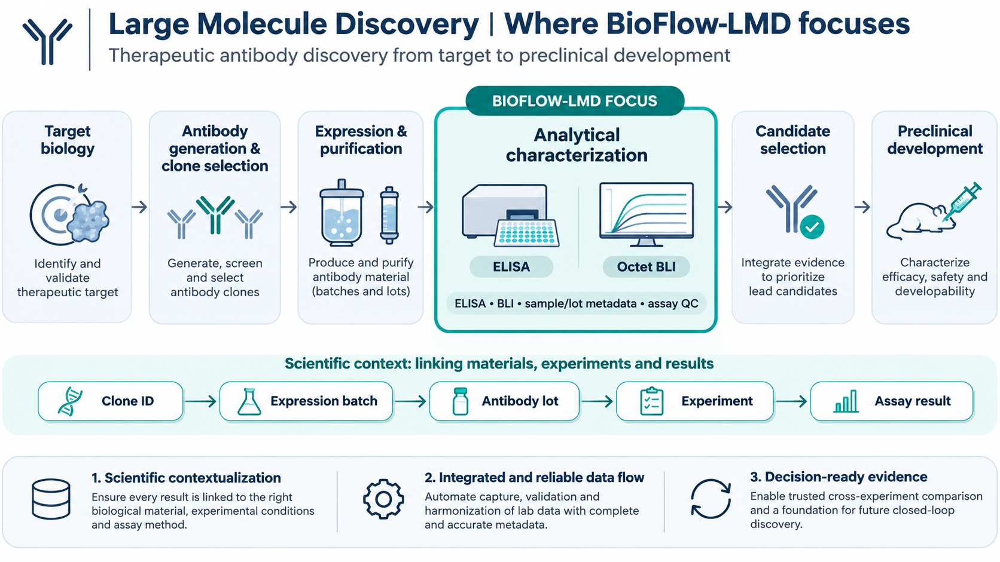
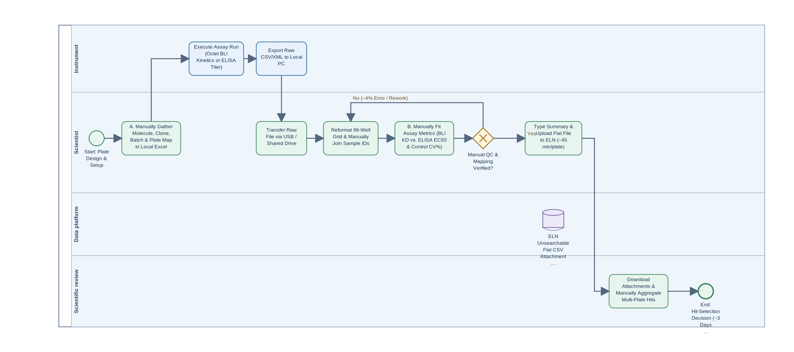
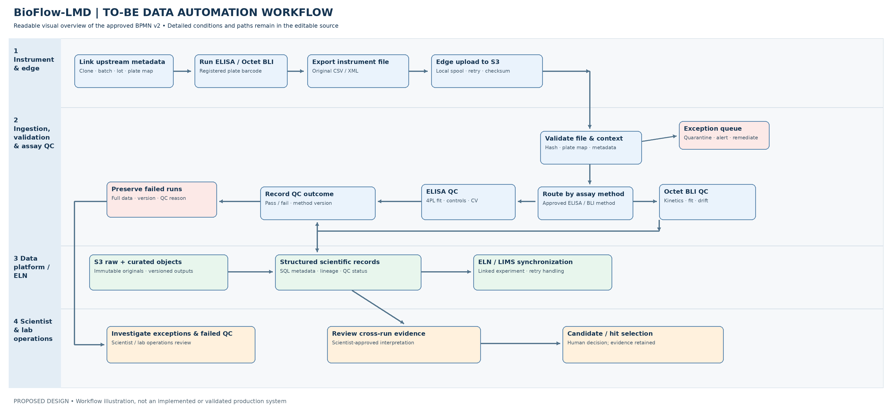
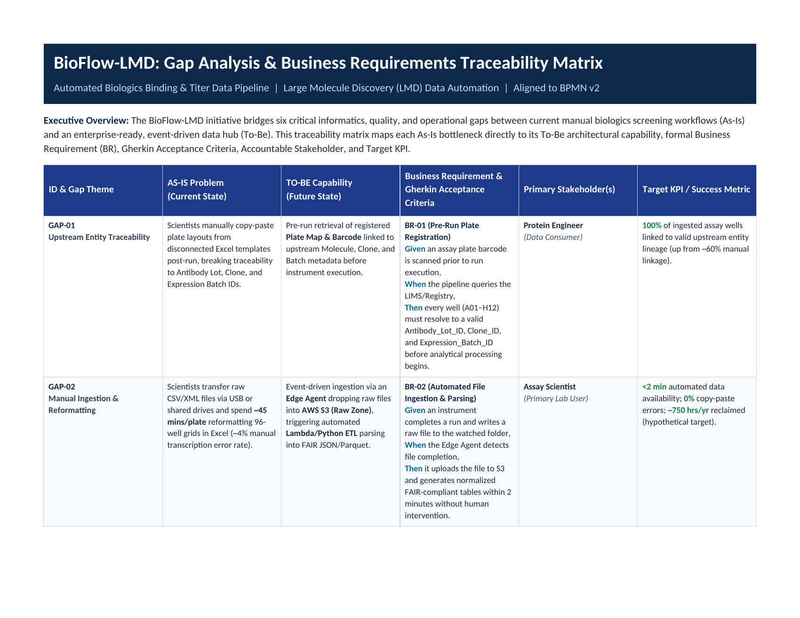
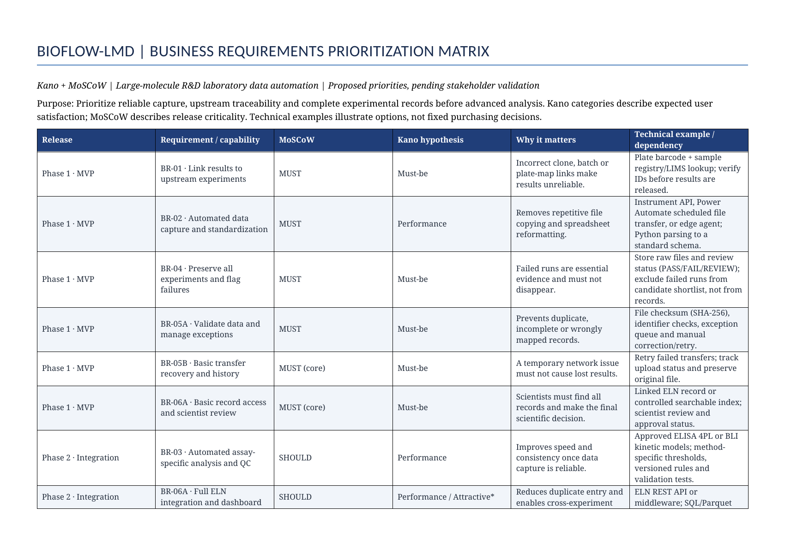
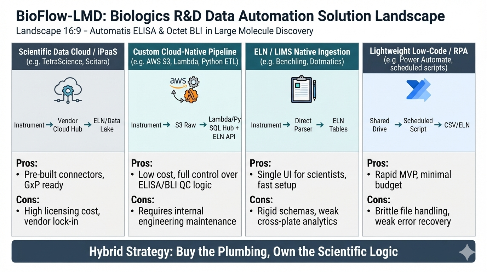

# BioFlow-LMD | Scientific Data Automation for Large Molecule Discovery

**A scientific Business Owner case study** · ELISA and Octet BLI analytical characterization · Proposed workflow and solution assessment

## Purpose and problem statement

During **large-molecule discovery**, assay scientists and protein engineers use **ELISA screening and Octet BLI characterization** to evaluate antibody candidates. These workflows produce instrument files alongside essential experimental context held in plate maps, spreadsheets and ELN/LIMS records. When files are manually exported, reformatted or stored separately from clone, expression-batch and antibody-lot information, retrieving and comparing results across experiments can require substantial reconciliation. This creates a practical opportunity for **scientific data automation**: reduce manual handoffs while preserving the identity, quality and provenance of every result.

**BioFlow-LMD** assesses that opportunity through the analytical characterization stage of antibody discovery. The project uses AS-IS and TO-BE process mapping, requirements analysis, prioritization and solution evaluation to address three connected objectives:

1. **Automate reliable data capture and integration** — preserve original ELISA/BLI outputs, standardize measurements, manage duplicates and recovery, and connect data with existing informatics systems.
2. **Establish accurate scientific contextualization** — validate the relationship between each applicable measurement, its clone, expression batch, antibody lot, plate map, assay conditions and method version.
3. **Deliver traceable, decision-ready evidence** — retain all runs, distinguish technical checks from assay QC and scientist review, and enable responsible cross-experiment analysis.

**Business Owner question:** Which capabilities should be delivered first, what scientific and technical acceptance criteria demonstrate value, and when should the organization **reuse or buy established integration infrastructure versus tailor its scientific data logic**?

### Explore visually

[**Discovery stage and scope**](#where-bioflow-lmd-fits) · [**AS-IS workflow**](#1-current-state--as-is) · [**TO-BE workflow**](#2-proposed-state--to-be) · [**Gap analysis and requirements**](#3-gaps-to-requirements) · [**Prioritization**](#4-delivery-priorities) · [**AWS technology options**](#aws-services-in-the-proposed-technical-pattern) · [**Solution landscape**](#5-solution-landscape-and-recommendation)

## Where BioFlow-LMD fits

The case study focuses on the **analytical characterization** stage of antibody discovery, where ELISA and Octet BLI results must remain connected to the materials and experimental conditions that produced them.

*Click the image to view it at full size.*

## Business Owner perspective: science translated into digital delivery

| Laboratory requirement | Digital capability / delivery question | Acceptance evidence to specify |
|---|---|---|
| Trace the tested antibody material | Controlled ELN/LIMS IDs; plate-map and clone–batch–lot relationship checks | A mismatched lot is flagged; the original measurement remains available |
| Reduce manual file handling | Instrument connector, standardized parser and safe retry | Complete files are ingested; duplicates and transfer failures are visible |
| Preserve all experimental evidence | Original-file retention, QC/review statuses and exception handling | Failed runs remain traceable but do not silently enter candidate shortlists |
| Compare experiments responsibly | Searchable records linked to assay method, conditions and QC | Scientists can retrieve eligible results and their provenance |

**Ownership boundary:** the Business Owner defines scientific outcomes, priorities, data-quality expectations and acceptance criteria with stakeholders. Engineers and architects select and implement the technology; scientific SMEs approve assay methods.

## Project work: from workflow to delivery decision

### 1. Current state — AS-IS

**Finalized workflow:** [Open the AS-IS BPMN diagram](supporting/AS_IS_Workflow.bpmn) in [Camunda Modeler](https://camunda.com/download/modeler/).

Mapped manual export and reformatting, fragmented ELN/instrument records, and breaks in upstream sample traceability.

[**View AS-IS PNG**](assets/as_is_workflow.png) · [**Download editable AS-IS BPMN**](supporting/AS_IS_Workflow.bpmn)

### 2. Proposed state — TO-BE

**Finalized workflow:** [Open the TO-BE BPMN diagram](supporting/TO_BE_Workflow.bpmn) in [Camunda Modeler](https://camunda.com/download/modeler/).

Proposed automated capture, raw-file preservation, scientific metadata matching, integrity/exception controls and scientist-led review. **Every experiment, including failed runs, remains recorded.**

[**View TO-BE PNG**](assets/to_be_workflow.png) · [**Download editable TO-BE BPMN**](supporting/TO_BE_Workflow.bpmn)

### 3. Gaps to requirements

| Business requirement | Scope |
|---|---|
| **BR-01** | Upstream clone, expression-batch and antibody-lot linkage |
| **BR-02** | Instrument capture and data standardization |
| **BR-03** | Approved assay-specific QC |
| **BR-04** | Retention of all experiments, including failures |
| **BR-05A / BR-05B** | Integrity checks, exceptions, retries and versioning |
| **BR-06A / BR-06B** | Scientist review, searchable records, ELN integration and optional advanced search |

[**Full gap analysis and BR matrix**](supporting/Gap_Analysis_and_Business_Requirements.docx)

### 4. Delivery priorities

| Release | Agreed priority | Why this sequence? |
|---|---|---|
| **Phase 1 — MUST** | Upstream linkage, capture, all-run retention, integrity/exception handling, core retry and scientist review | Establish trustworthy, traceable records |
| **Phase 2 — SHOULD** | Validated automated assay QC, fuller ELN sync, enhanced recovery and cross-run dashboards | Extend automation once data foundations are reliable |
| **Phase 3 — COULD** | Permission-scoped advanced search / AI assistance | Explore only after data governance and scientific verification |

[**Full prioritization assessment**](supporting/Prioritization_Matrix.docx)

### Requirements validation and traceability

| Deliverable | What it demonstrates | Open document |
|---|---|---|
| **User stories and acceptance criteria** | Translates scientific workflow needs into testable system behavior | [View user stories](supporting/User_Stories.docx) |
| **Proposed UAT scenarios** | Defines how data integrity, exception handling and scientist review would be verified | [View UAT matrix](supporting/UAT_Matrix.docx) |
| **Requirements traceability matrix (RTM)** | Connects gaps, business requirements, delivery phases and proposed tests | [View RTM](supporting/RTM.docx) |

*These are proposed acceptance and verification artifacts; UAT has not been executed.*

## The data automation design choice

**Different data types need different handling.** Original ELISA/BLI exports should remain preserved as source evidence; standardized measurement records and linked scientific metadata should be structured for retrieval, validation and analysis. They complement each other rather than competing as storage approaches.

### AWS services in the proposed technical pattern

| Technical need | Illustrative AWS capability | Business requirement it supports |
|---|---|---|
| Preserve original CSV/XML and other instrument outputs | **Amazon S3 object storage** | Raw-file provenance and retention; files are stored as objects, **not as rows in a SQL table** |
| Respond to completed file arrival | **S3 event notifications + AWS Lambda** | Trigger lightweight parsing, validation or downstream processing |
| Coordinate multi-step jobs, retries and exceptions | **AWS Step Functions**, where complexity justifies it | Controlled recovery and auditable processing states |
| Make linked results and metadata queryable | **Amazon RDS / relational SQL** | Clone–batch–lot–experiment–result relationships and cross-run queries |
| Control access and observe failures | **IAM + CloudWatch** | Permissions, operational monitoring and investigation |

**Illustrative flow:** ELISA/BLI file → controlled transfer → **S3 raw object** → event-triggered processing → plate-map and material-identity validation → **structured SQL results and metadata** → scientist review / existing ELN integration.

This is a **possible AWS implementation pattern, not an implemented architecture or mandatory stack**. Existing ELN/LIMS features, enterprise platforms and supported connectors should be evaluated before custom development. Automated scientific QC belongs to the later, method-validated phase.

### Why metadata matters to the technical design

A successfully transferred file may still be unusable for candidate comparison if its antibody lot, expression batch or assay conditions are wrong or missing. The proposed controls distinguish **completeness**, **valid identifiers**, **correct relationships**, **assay QC** and **scientist approval**. Requirements differ by record type: blanks and controls do not need sample-clone fields where those fields are inapplicable.

## 5. Solution landscape and recommendation

Four routes were considered: **specialist scientific data platforms** (TetraScience, Scitara, Ganymede), **custom cloud integration**, **existing ELN/LIMS capabilities**, and **lightweight/low-code automation**. Each has trade-offs in supported instrument formats, metadata flexibility, reliability, security, operating cost and maintenance.

### Buy the plumbing; own the scientific logic

**Recommended starting point: a pragmatic hybrid.** Reuse the ELN/LIMS as the authoritative material registry; configure or buy supported instrument connectivity and managed infrastructure; tailor scientific metadata mappings, relationship validation, exception handling and assay-specific requirements where existing capabilities fall short.

The decision should follow a scoped proof of concept comparing available tools against the **same scientific acceptance scenarios**. Avoid building infrastructure that a supported, maintainable solution already provides.

[**Full solution landscape and build-vs-buy assessment**](supporting/Solution_Landscape.docx)

## How success would be assessed

**Proposed measures:** verified clone–batch–lot linkage rate for applicable samples; metadata exception rate and resolution; traceability to original files and review decisions; duplicate/retry performance; time to review-ready results; and scientist ability to retrieve valid cross-run comparisons.

The requirements validation and traceability documents above connect proposed requirements to verification. Any numerical targets are **illustrative until measured in a pilot**.

## Portfolio scope

BioFlow-LMD is a **proposed business-analysis and solution-evaluation case study**, not a deployed pipeline. BPMN models, requirements, prioritization, proposed UAT and build-versus-buy work are documented; live AWS/ELN integration, a working Python prototype, executed UAT, verified savings and production AI are **not claimed**.

**Takeaway:** scientific data automation succeeds when reliable integration preserves the biological meaning and provenance of the data—and when the solution is scoped, prioritized and verified against real scientific workflows.
